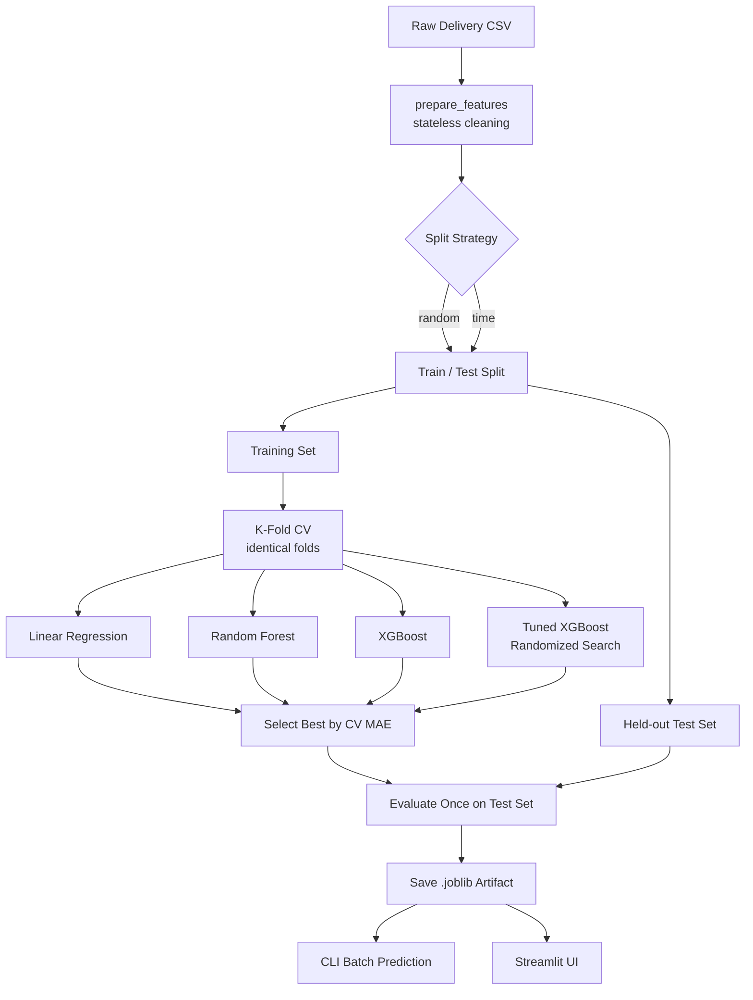
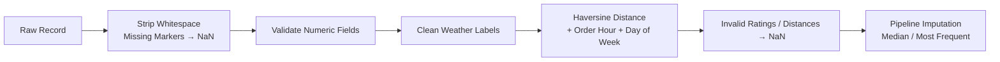

<div align="center">

# 🛵 Food Delivery Time Prediction

### Leakage-Safe, Reproducible Regression Pipeline

**Predicts food-delivery time in minutes from order, rider, route, traffic, and weather data — with identical-fold model comparison, tuned XGBoost, a single-use test set, and one portable deployable artifact.**

[](https://www.python.org/)
[](https://scikit-learn.org/)
[](https://xgboost.readthedocs.io/)
[](https://streamlit.io/)
[](#-license)

🔗 **Live Demo:** _add your Streamlit app link here_

</div>

---

## 📌 Overview

**Food Delivery Time Prediction** is a production-oriented regression project that estimates delivery time in minutes from raw delivery records.

Instead of a notebook-only workflow, the project trains and compares multiple regression models, tunes XGBoost, evaluates the selected model once on a held-out test split, and saves a **single deployable artifact** containing the complete preprocessing pipeline and model.

The project is built around one core principle:

> **No statistic is learned from data it shouldn't see: all cleaning is stateless, and all fitted preprocessing lives inside one pipeline.**

---

## ✨ Key Capabilities

### 🧹 Data Preparation

- **Stateless feature preparation** via `prepare_features()`, the single place where raw data is cleaned.
- **Haversine distance** between restaurant and delivery coordinates.
- **Time features** such as order hour and day of week.
- **Robust cleaning** of missing-value markers, invalid ratings, invalid coordinates, and inconsistent categorical labels.

### 🤖 Modeling

- **Identical-fold comparison** of Linear Regression, Random Forest, and XGBoost.
- **Randomized hyperparameter search** for XGBoost.
- **CV-MAE model selection**, with the test set used only once after selection.
- **Flexible splitting:** random split or time-based split using order dates.

### 🛡️ Leakage Safety & Reproducibility

- **Single scikit-learn `Pipeline`** holding imputation, categorical encoding, scaling, and the model.
- **Imputation statistics learned only from training data.**
- **No column drift at inference:** one-hot encoding is fitted once and stored in the pipeline.
- **No separate scaler file** to manage.

### 📈 Evaluation & Diagnostics

- **MAE, RMSE, and R²** on the held-out test set.
- **MAE breakdowns** by traffic density and city type to find where the model performs poorly.
- **EDA charts:** delivery-time distribution, delivery time by hour and traffic level, and numeric-feature correlations.

### 📦 Deployment Readiness

- **One portable `.joblib` artifact** with pipeline, feature metadata, model choice, CV comparison, test metrics, and training provenance.
- **CLI** for training and batch prediction.
- **Streamlit UI** for local interactive predictions.

---

## 📊 Results

| Evaluation Area | Result |
|---|---:|
| Models compared | 4 (Linear, Random Forest, XGBoost, Tuned XGBoost) |
| Model-selection metric | Cross-validation MAE |
| Test-set usage | Once, after model selection |
| Selected model | _fill after training_ |
| Test MAE (min) | _fill after training_ |
| Test RMSE (min) | _fill after training_ |
| Test R² | _fill after training_ |

> Run `train` and copy the values from the saved artifact's `cv_comparison` and `test_metrics` fields into this table.

---

## 🏗️ Architecture



### Training Flow

1. **Stateless preparation** cleans raw records and engineers distance, order hour, and day of week.
2. **Split** the data using a random or time-based strategy.
3. **Build a single `Pipeline`** with imputation, encoding, scaling, and the regressor.
4. **Cross-validate** all candidate models on identical K-fold splits.
5. **Tune XGBoost** with randomized hyperparameter search.
6. **Select** the final model by cross-validation MAE.
7. **Evaluate once** on the held-out test set (MAE, RMSE, R²) and log MAE by traffic density and city type.
8. **Optionally refit** the selected model on all available data.
9. **Save** the full artifact as a single `.joblib` file.

---

## 🧪 Data-Quality Rules



- Ratings outside the range **0–5** are treated as missing.
- Delivery distances of **100 km or more** are treated as invalid coordinates.
- Missing numeric values are imputed with the **median**.
- Missing categorical values are imputed with the **most frequent value**.
- Traffic density is **ordinal-encoded**: `Low → Medium → High → Jam`.
- Unknown categorical values at inference time are **safely handled by the encoder**.

---

## 🧩 Tech Stack

| Layer | Tools |
|---|---|
| Data handling | pandas, NumPy |
| Modeling & preprocessing | scikit-learn (`Pipeline`) |
| Gradient boosting | XGBoost |
| Persistence | Joblib |
| Visualization | Matplotlib |
| UI | Streamlit |
| Interface | Python CLI |

---

## 📂 Project Structure

```text
.
├── food_delivery_pipeline.py       # Training, evaluation, and inference pipeline
├── ui.py                           # Streamlit user interface
├── main.ipynb                      # Exploratory analysis notebook
├── Food delivery.csv               # Training dataset
├── new_orders.csv                  # Example inference input
├── preds.csv                       # Example prediction output
├── requirements.txt                # Python dependencies
├── models/
│   └── delivery_time_model.joblib  # Saved model artifact
└── reports/
    ├── correlation.png
    ├── target_distribution.png
    └── time_by_hour_and_traffic.png
```

---

## 🚀 Quick Start

### 1. Clone and install

```bash
git clone https://github.com/rj1230/<your-repo-name>.git
cd <your-repo-name>
pip install -r requirements.txt
```

> Requires **Python 3.10+**.

### 2. Train the model

```bash
python food_delivery_pipeline.py train --data "Food delivery.csv"
```

Common training options:

| Goal | Flag |
|---|---|
| Generate EDA charts | `--eda` |
| Time-based split (hold out most recent orders) | `--split time` |
| Random split | `--split random` |
| More XGBoost search candidates | `--n-iter 50` |
| Refit selected model on all data before saving | `--refit-full` |
| Custom model output path | `--model models/my_model.joblib` |

Example combining options:

```bash
python food_delivery_pipeline.py train --data "Food delivery.csv" --split time --eda --n-iter 50
```

### 3. Run batch predictions

```bash
python food_delivery_pipeline.py predict \
  --model models/delivery_time_model.joblib \
  --input new_orders.csv \
  --output preds.csv
```

The output file contains:

```text
ID,predicted_minutes
```

If the input file has no `ID` column, only `predicted_minutes` is written.

### 4. Launch the Streamlit UI

```bash
streamlit run ui.py
```

---

## 🔑 Inputs & Target

### Required input columns

| Group | Columns |
|---|---|
| Rider | `Delivery_person_Age`, `Delivery_person_Ratings`, `Vehicle_condition`, `Type_of_vehicle` |
| Route | `Restaurant_latitude`, `Restaurant_longitude`, `Delivery_location_latitude`, `Delivery_location_longitude`, `City` |
| Order | `Time_Orderd`, `Order_Date`, `Type_of_order`, `multiple_deliveries`, `Festival` |
| Conditions | `Weatherconditions`, `Road_traffic_density` |

### Target column

```text
Time_taken(min)
```

---

## 📦 Model Artifact

The saved artifact is a dictionary stored at `models/delivery_time_model.joblib`.

| Key | Description |
|---|---|
| `pipeline` | Full preprocessing and regression pipeline |
| `features` | Final model feature names |
| `raw_columns` | Required raw input columns |
| `selected_model` | Name of the selected model |
| `cv_comparison` | Cross-validation metrics for all candidates |
| `test_metrics` | MAE, RMSE, and R² on the held-out test set |
| `meta` | Training timestamp, split type, library versions, and refit status |

---

## 🧪 Evaluation Coverage

- **Model comparison:** Linear Regression, Random Forest, XGBoost, and Tuned XGBoost on identical CV folds.
- **Primary metrics:** MAE (minutes), RMSE (minutes), and R².
- **Segment diagnostics:** MAE by traffic density and by city type.
- **Split robustness:** random split and time-based split for temporal generalization.
- **Leakage control:** imputation, encoding, and scaling fitted only on training data inside the pipeline.

---

## 🛡️ Reliability Model

This project uses a defense-in-depth approach to avoid optimistic estimates:

- **Stateless pre-split cleaning:** `prepare_features()` learns nothing from data, so it is safe before the split and at inference.
- **Pipeline-contained fitting:** all learned preprocessing lives inside one `Pipeline`.
- **Identical CV folds:** every candidate is compared on the same splits.
- **Single-use test set:** the test split is touched only after model selection.
- **Schema safety:** `raw_columns` and `features` are stored with the model to catch input drift.
- **Provenance:** timestamp, split type, library versions, and refit status are saved in `meta`.
---

## 📄 License

This project is available for educational and portfolio use.
